  

Full-stack engineer and Software Engineering student at Fontys. I build products end to end, from the data model to the interface, and lately a lot of it involves LLMs and agents.

### Work

<picture>
  <source media="(prefers-color-scheme: dark)" srcset="assets/work-dark.svg"/>
  
</picture>

### Stack

<picture>
  <source media="(prefers-color-scheme: dark)" srcset="assets/stack-dark.svg"/>
  
</picture>

### Activity

<picture>
  <source media="(prefers-color-scheme: dark)" srcset="assets/activity-dark.svg"/>
  
</picture>

🦎 That's a <b>calango</b>, a small Brazilian lizard. It eats my contribution graph every day.
