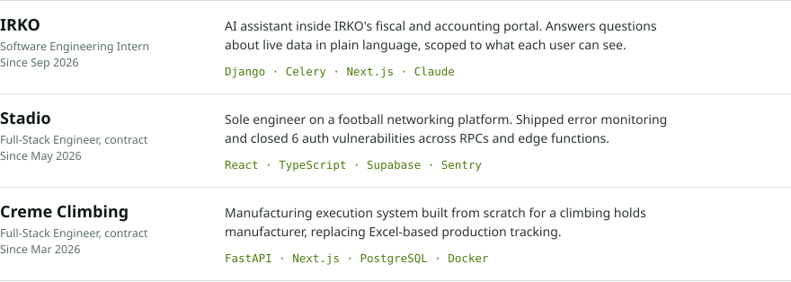

  

Full-stack engineer, Brazilian and Spanish, studying Software Engineering at **Fontys** in the Netherlands. Right now I'm back in São Paulo interning at **IRKO**, building an AI assistant that answers questions about fiscal and accounting data, and in February I head back to the Netherlands to finish my degree. Alongside that, I work as a contractor on two products, **Stadio** and **Creme Climbing**.

I like owning a product end to end: the data model, the API, the interface and the pipeline that ships it. Lately most of my work involves LLMs and agents, and making sure the answers they give can actually be trusted.

### Work

<picture>
  <source media="(prefers-color-scheme: dark)" srcset="assets/work-dark.svg"/>
  
</picture>

### Stack

<picture>
  <source media="(prefers-color-scheme: dark)" srcset="assets/stack-dark.svg"/>
  
</picture>

### Activity

<picture>
  <source media="(prefers-color-scheme: dark)" srcset="assets/activity-dark.svg"/>
  
</picture>

🦎 That's a <b>calango</b>, a small Brazilian lizard. It eats my contribution graph every day ;)
