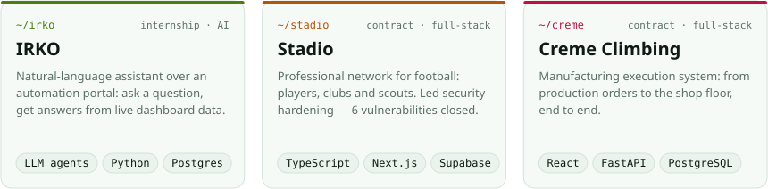
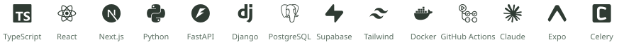
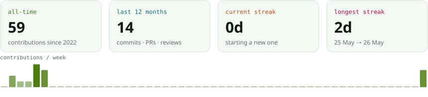

  

### About

I build products end to end, from the database schema to the last pixel. Right now that means **AI assistants that turn plain language into answers from live data**, a **manufacturing execution system**, and a **professional network for football**. I care about clean APIs, typed code and shipping things people actually use.

- **Day to day:** TypeScript, React, Next.js on the front · FastAPI and Python on the back · PostgreSQL and Supabase for data
- **Also comfortable with:** mobile (React Native), Docker, CI/CD with GitHub Actions

### Projects

<picture>
  <source media="(prefers-color-scheme: dark)" srcset="assets/projects-dark.svg"/>
  
</picture>

### Stack

<picture>
  <source media="(prefers-color-scheme: dark)" srcset="assets/stack-dark.svg"/>
  
</picture>

### Activity

<picture>
  <source media="(prefers-color-scheme: dark)" srcset="assets/stats-dark.svg"/>
  
</picture>

<picture>
  <source media="(prefers-color-scheme: dark)" srcset="assets/calango-dark.svg"/>
  
</picture>

🦎 That's a <b>calango</b>, a small Brazilian lizard. It eats my contribution graph every day.
